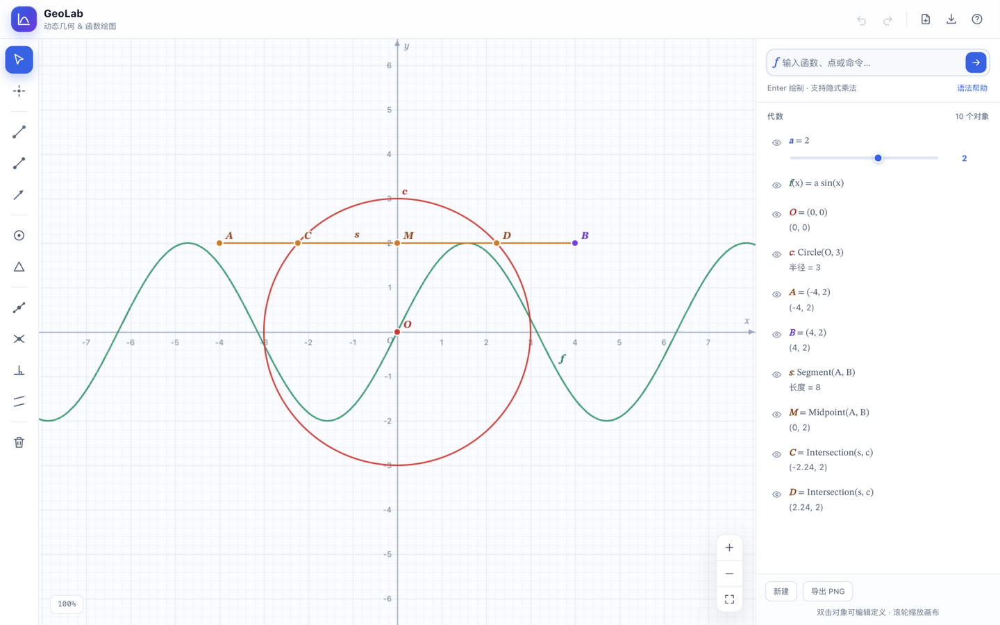

# GeoLab

一个零依赖、纯前端的动态几何与函数绘图工具，交互方式参考 GeoGebra。打开 `index.html` 即可使用，不需要安装或构建。

纯原生 JavaScript · Canvas 2D · 无外部依赖



## 打开方式

- 直接双击 `index.html`（推荐 Chrome / Edge / Safari）。
- 或在当前目录启动一个静态服务器：

  ```bash
  python3 -m http.server 8000
  # 浏览器访问 http://127.0.0.1:8000
  ```

作图内容会自动保存到浏览器 `localStorage`，刷新或重新打开后会恢复。

## 功能

- 函数图像：显式函数、三角/指数/对数等常用函数、分段间断与渐近线处理
- 隐式曲线：`x^2 + y^2 = 9`、`x*y = 1`、`y^2 = x` 等（Marching Squares）
- 动态几何：点、直线、线段、向量、圆、多边形、中点、交点、垂线、平行线、垂直平分线
- 对象依赖：拖动自由点，线段、圆、交点、多边形等会实时联动
- 数值滑块：任意数值对象都可以用滑块调节，并驱动函数、点坐标、圆半径和方程
- 代数面板：查看定义与实时数值、显示/隐藏、删除、双击编辑
- 视图：滚轮缩放（指向光标缩放）、拖动画布平移、重置视图
- 撤销/重做、PNG 导出、本地自动保存
- 响应式布局，窄屏下代数面板变为抽屉

## 输入示例

| 输入 | 效果 |
| --- | --- |
| `y = x^2` | 抛物线 |
| `f(x) = sin(2x)` | 命名函数 |
| `a = 2` | 数值滑块 |
| `y = a x^2` | 用滑块控制函数（先创建 `a`） |
| `A = (1, 2)` | 命名点 |
| `(a, 0)` | 坐标依赖滑块的动态点 |
| `x^2 + y^2 = 9` | 隐式方程 / 圆 |
| `x*y = 1` | 隐式双曲线 |
| `Line(A, B)` | 过两点的直线 |
| `Segment(A, B)` | 线段 |
| `Vector(A, B)` | 向量 |
| `Circle(A, B)` | 以 A 为圆心、过 B 的圆 |
| `Circle(A, 3)` | 以 A 为圆心、半径 3 的圆 |
| `Polygon(A, B, C)` | 多边形 |
| `Midpoint(A, B)` | 中点 |
| `Intersection(a, c)` | 两个对象的交点（可为 0/1/2 个） |
| `PerpendicularLine(A, a)` | 过 A 且垂直于 a 的直线 |
| `ParallelLine(A, a)` | 过 A 且平行于 a 的直线 |
| `PerpendicularBisector(A, B)` | AB 的垂直平分线 |

表达式支持隐式乘法（`2x`、`3(x+1)`、`a x^2`）、乘方、括号、`pi`/`e` 常量，以及 `sin`、`cos`、`tan`、`sqrt`、`abs`、`ln`、`log`、`exp`、`floor`、`ceil`、`min`、`max` 等函数。也接受 `×`、`÷`、`−` 和上标 `²`/`³`。

## 快捷键

| 操作 | 快捷键 |
| --- | --- |
| 移动 / 点 / 直线 / 线段 / 向量 | `V` / `P` / `L` / `S` / `W` |
| 圆 / 多边形 / 中点 / 交点 | `C` / `G` / `M` / `I` |
| 垂线 / 平行线 / 删除 | `N` / `R` / `D` |
| 撤销 / 重做 | `Ctrl/Cmd + Z` / `Ctrl/Cmd + Shift + Z` |
| 删除选中对象 | `Delete` |
| 取消当前作图 / 关闭弹窗 | `Esc` |
| 完成多边形 | 点击起点 / `Enter` / 双击 |

在代数面板中双击点、函数或数值对象，可以把它当前的定义填入输入框进行修改。

## 文件结构

```
geolab/
├─ index.html      # 页面结构
├─ styles.css      # 界面样式与设计令牌
├─ design.md       # 视觉设计系统（ikadesign3 格式）
├─ preview.png     # 界面预览
├─ review/         # 设计测量、评审记录与前后截图
└─ js/
   ├─ parser.js    # 数学表达式解析与编译
   ├─ geom.js      # 几何计算（交点、裁剪、多边形面积等）
   └─ app.js       # 状态、渲染、工具交互、代数面板
```

界面遵循 `design.md` 中的令牌、排版、间距、焦点态和响应式规则。评审记录在 `review/review-record.md`。

## 已知限制

- 暂不支持函数嵌套调用（如 `g(x) = f(x) + 1`）和函数/隐式曲线之间的交点。
- 暂不支持圆锥曲线命令、导数、积分、参数方程、3D 视图。
- 交点对象只支持直线、线段、向量和圆之间的两两求交。
- 点只能自由拖动或由坐标表达式/中点/交点生成，暂不支持“吸附到对象上”的约束点。

## License

MIT
